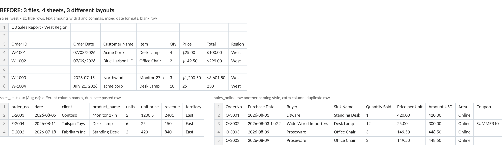
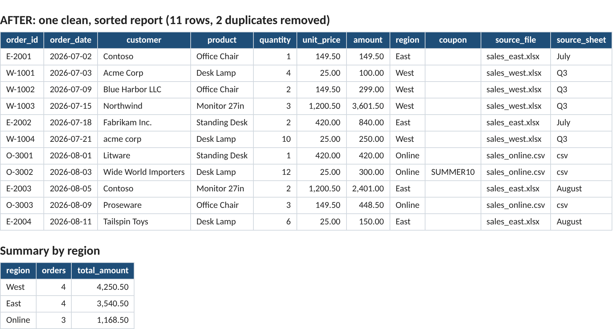

# Excel & CSV Merge and Clean-up

Turn a folder of inconsistent spreadsheets into **one clean, formatted Excel report** in seconds.




## The problem

Sales, inventory or HR data often arrives as many files from different people:
different column names, title rows above the header, `$1,200.50` stored as text,
dates in three formats, blank rows and rows pasted twice. Cleaning that by hand
takes hours and is easy to get wrong.

## What this tool does

- Reads every `.xlsx`, `.xlsm` and `.csv` file in a folder, **including every sheet**
- Detects the real header row even when there are title rows above it
- Maps different column names to one standard name (`Order No`, `order_no`, `OrderNo` → `order_id`)
- Cleans values: trims spaces, converts `$1,200.50` / `(300)` to numbers, parses mixed date formats
- Removes duplicate rows (whole-row, or by key columns you choose)
- Keeps `source_file` and `source_sheet` on every row so any number can be traced back
- Skips unreadable files and lists them instead of crashing

## The report

| Sheet | Contents |
|---|---|
| Merged | All cleaned rows, sorted by date, with filters, frozen header and number formats |
| Overview | Files read, rows cleaned, duplicates removed, final row count |
| Per file | Row count from each file and sheet |
| By region | Order count and total amount per region (when those columns exist) |
| Duplicates removed | Every row that was dropped, so nothing disappears silently |

Example output: [output/merged_report.xlsx](output/merged_report.xlsx)

## Usage

```bash
pip install -r requirements.txt

python make_sample_data.py sample_data          # optional: create demo files
python merge_excel.py sample_data -o output/merged_report.xlsx
```

Options:

```bash
--key order_id          # treat rows with the same order_id as duplicates
--dayfirst              # read 03/07/2026 as 3 July (European format)
--mapping columns.json  # add your own column names, see below
```

`columns.json` example:

```json
{
  "aliases": { "customer": ["account holder"], "invoice_no": ["inv #", "invoice"] },
  "date_columns": ["ship_date"],
  "numeric_columns": ["discount"]
}
```

## Tests

```bash
python -m pytest -q
```

## Tech

Python, pandas, openpyxl. Runs on Windows, macOS and Linux. Can be packaged as a
one-click `.exe` or scheduled to run daily.
