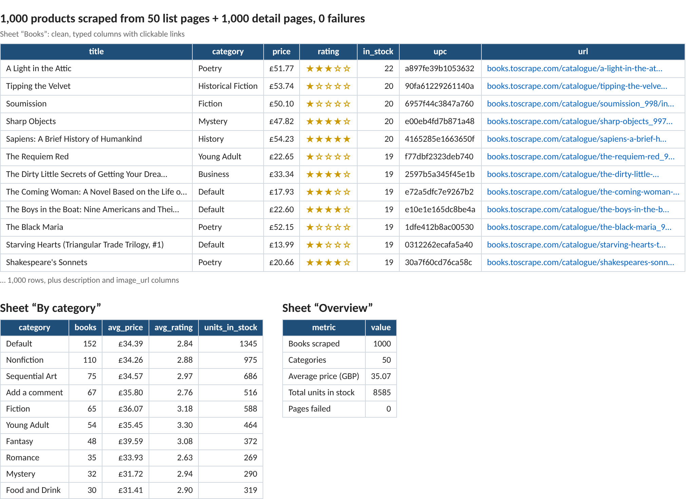

# Web Scraping to Excel: Product Catalogue

Scrapes a full product catalogue (list pages → detail pages) into a **clean, typed Excel report**
with summaries, plus a CSV of the full data.



## Result

- **1,000 products** from 50 list pages and 1,000 detail pages, **0 failures**
- About 9 minutes at a polite 0.5 s between requests (≈1,050 requests in total)
- Fields: title, category, price, star rating (1–5), units in stock, UPC, description, product URL, image URL

Example output: [output/books.xlsx](output/books.xlsx) · [output/books.csv](output/books.csv)

Target site: [books.toscrape.com](https://books.toscrape.com), a public sandbox built for
scraping practice. The categories "Default" and "Add a comment" are real categories on that site.

## How it works

1. Follows the "next" link through every list page and collects product URLs
2. Downloads detail pages in parallel (4 workers) with a shared rate limit
3. Parses each page into typed fields: `£51.77` → `51.77`, `star-rating Three` → `3`,
   `In stock (22 available)` → `22`
4. Writes an Excel report: Overview, Books (clickable links, filters, frozen header),
   By category (count, average / min / max price, average rating, stock), Top rated (cheapest)
5. Pages that fail are retried, then listed on an Errors sheet instead of stopping the run

## Responsible scraping built in

- Delay between requests (`--delay`) and automatic retry with back-off on 429 / 5xx errors
- Optional HTML cache (`--cache`) so re-runs and fixes don't hit the site again
- Identifies itself with a clear User-Agent

## Usage

```bash
pip install -r requirements.txt

python scrape_books.py -o output/books.xlsx --csv output/books.csv
python scrape_books.py --max-pages 2            # quick test: first 40 products
python scrape_books.py --cache .cache --delay 1 # slower, cached
```

## Tests

Offline tests use saved pages and a fake site, so they never touch the network:

```bash
python -m pytest -q
```

## Tech

Python, requests, BeautifulSoup, pandas, openpyxl. The same approach adapts to
directories, real estate listings, job boards and e-commerce sites; sites that need a real browser
(JavaScript rendering or logins) can be handled with Playwright.
